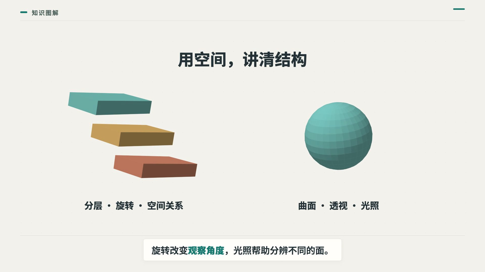

# Semantic Motion

把知识讲清楚，再让动画解释原理。中文科普动画 Skill + 二维与基础三维渲染器。

**v0.12.0-alpha.6 · 试验版**。白底蓝色科技界面，可选中文男声配音和字幕同步。默认 16:9、1920×1080、无声，输出 MP4、讲稿、字幕和时间标记。面向用户提出的知识问题：科学、科技、经济、心理、历史和产品概念等。内容与分镜由 AI 根据主题设计，同一个引擎负责渲染。



## 安装与使用

本仓库发布的是可重复使用的 Skill 源码，不是某个主题的视频。核心入口是 `SKILL.md`，配套 `scripts/`、`src/`、`schemas/` 和 `references/`；`examples/` 仅用于验证和学习。

在 Codex 中输入：

> 请使用 skill-installer，从 https://github.com/kodiak-10/semantic-motion 安装根目录 Skill，名称为 semantic-motion。

安装后，在下一轮对话用 `$semantic-motion` 加上你自己的主题和制作要求。新主题需要 AI 研究资料、写讲稿和分镜；下方命令只是用于检查安装是否正常。

## 验证样例能运行

电脑安装 Node.js 22.18 或更新版本（建议 Node.js 24）。首次安装需要联网下载依赖和渲染浏览器。

下载本仓库：右上角 **Code → Download ZIP**，解压，在该文件夹打开终端，依次执行：

```sh
npm ci
npm run setup
npm run check
npm run demo
```

打开 `out/sky.mp4` 即可观看。另一个测试主题：

```sh
npm run demo:jev
```

结果在 `out/jev.mp4`。想先看单帧、缩短等待时间：`npm run preview`，结果在 `out/preview.png`。

讲稿、字幕和时间文件在对应的 `examples/flat/general-*/generated/` 下：`narration.md`、`narration.json`、`subtitle.srt`、`timing.json`。导入剪辑软件后可以自行配音。可选配音与同步方法见 [配音指南](references/voice.md)。

## 用自己的主题

**需要支持 Skill 和代码执行的 AI 助手。** 单独运行样例不会自动研究新主题；AI 需要先核实资料、编写讲稿和分镜，再用本项目生成动画。新主题的画面质量取决于资料和分镜设计，现有素材库仍有限。

在 Codex 中可先输入：

> 请使用 skill-installer，从 https://github.com/kodiak-10/semantic-motion 安装根目录 Skill，名称为 semantic-motion。

安装完成后，在下一轮对话输入：

> 使用 $semantic-motion，讲解“为什么冰会浮在水上”，面向普通大众，90 秒，先解释基本概念，再用具体例子演示机制和边界。使用浅色 Studio 风格，16:9，无声。输出视频、讲稿、字幕、关键帧和检查报告。

也可以直接在下载的项目文件夹打开 AI 助手，让它读取 `SKILL.md`，按同样要求执行。不会使用 Skill 的工具可以把 `SKILL.md` 当作制作指南。

手动制作流程见 [制作指南](references/authoring.md)。新主题使用新目录，不能只替换 Jev 的标题或沿用不相关的讲稿。

## Transformer 科技界面样片

`npm run demo:transformer` 生成 96 秒入门讲解，输出 `out/transformer.mp4`。从基本定义、文字表示、注意力加权讲到多头处理和预测边界。Tech Light 风格使用白色背景、深蓝文字、亮蓝与青蓝重点色；输入句子跨场景保留，选中的输出回到输入位置。权重、数字向量与概率均为教学示意，不是模型实测。讲稿与字幕在 `examples/flat/general-transformer/generated/`。

## 月相验证片

`npm run demo:moon` 渲染 42 秒月相短片。它使用同一内容编译与布局检查链，新增可复用受光球体；原创纹理为示意，不是真实月表。分镜与事实来源见 `examples/flat/general-moon/`，制作方法见 [镜头设计](references/shot-design.md)。这个样片不代表完整动画片质量。

## 体验可选 3D 模块

完成安装后运行 `npm run demo:3d`，结果在 `out/spatial.mp4`。这是一段组件演示，不是 Jev 视频，也不是完整知识内容。立方体和球体可用于新主题的分层、体积和视角展示，参数见制作指南。

## 项目目录

```text
SKILL.md          AI 助手的制作入口
src/              通用二维与基础三维动画引擎
scripts/          内容编译、渲染和布局检查
schemas/          知识计划的数据规范
references/       分镜与动画制作指南
docs/             预览与验证范围
examples/         可重建的测试主题与组件示例
public/           字体及其许可证
tests/            内容、动画和三维几何回归测试
```

不同主题应新建自己的知识计划与分镜，不修改引擎里的主题文案。默认预览使用通用空间组件；科学和 AI 示例仅用于回归验证。详细开发说明见 [CONTRIBUTING.md](CONTRIBUTING.md)。

## 已实现与限制

- 来源与知识结构检查：基本定义、前置知识、机制、例子、边界和记忆点；字幕必须与计划对应。
- 语义动作：路径绘制、状态变化、粒子重组、数量变化、物体拆分组合；支持本地图片。
- 3D 几何节点：三轴旋转、透视、面遮挡、方向光；当前支持立方体与球体，不含角色骨骼或复杂模型导入。
- Studio / Ink / Midnight / Tech / Tech Light 配色；中文短语字幕、随物体移动的标签。
- 渲染前逐帧检查文字和物体布局；有意接触必须声明对象和时间。
- 自动检查只能发现已覆盖的结构和几何问题，**不能证明事实准确、动画好看或所有遮挡都不存在**。成片仍需人工观看。
- 当前内容编译使用中文、16:9、无声时间线；可选配音步骤支持服务时间戳同步。不是完整动画片制作软件，也不保证任意主题一键生成优质成片。

## 开源与素材

项目原创代码采用 MIT，见 [LICENSE](LICENSE)。字体使用 SIL OFL，见 [字体许可证](public/fonts/OFL.txt)。依赖适用各自许可证，包括 Remotion；使用前请查看 [第三方说明](THIRD_PARTY_NOTICES.md)。公开包不包含私人录音、历史配音、第三方产品截图或参考视频。
